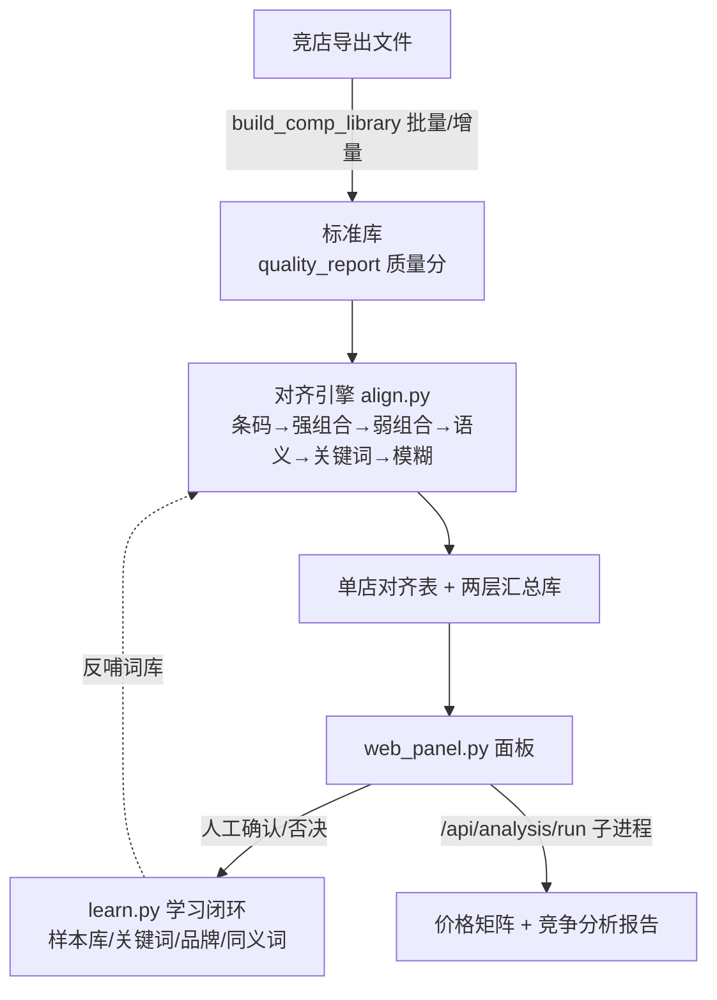

# 竞争面板逻辑分析

> 针对 `<项目根目录>\` 目录下「竞争分析 Web 面板 + 商品对齐引擎」全量代码通读整理。
> 结论基于 `scripts/web_panel.py`（约 3300 行，Flask 主程序）及配套模块逐行核对。

---

## 一、系统定位

这是一套 **「竞品商品库 → 商品对齐 → 竞争分析」** 的一体化工具：

| 环节 | 目标 | 主要产物 |
|---|---|---|
| 建库 | 把 19 家竞店不同格式的导出表，统一成一张标准表 | `output/竞店标准库/`（标准表+汇总库+质量报告） |
| 对齐 | 把竞品 SKU 对应到自家 SKU / SPU（品） | `output/试跑_<店>/对齐_*.xlsx` + 两层汇总库 |
| 分析 | 价格 / 热销 / 品类对标 | `output/竞品价格矩阵.xlsx`、`output/竞争分析报告.xlsx` |
| 查阅 | 人工在线确认、检索、反向查询、下钻 | `scripts/web_panel.py`（Flask 面板） |

核心矛盾是：**竞店表结构五花八门、同品不同名、自家条码覆盖率低**，因此整个系统围绕「多层匹配 + 人工确认 + 学习反哺」三层防线设计。

---

## 二、数据资产全景

| 文件/目录 | 职责 | 关键点 |
|---|---|---|
| `config/analysis_shops.yaml` | 参与分析的门店清单 | `--shops` 参数来源 |
| `config/` 其他配置 | 品牌词典、类目映射、关键词库等 | 对齐引擎的"词库养料" |
| `自家商品库/` + `自家商品库_标准版本.xlsx` | 自家侧 SKU/SPU 数据 | 条码 13 位 EAN，ID 一律字符串 |
| `output/试跑_<店>/竞品_归一化后.xlsx` | 单店竞品标准化表 | 面板按店实时加载 |
| `output/试跑_<店>/对齐_SPU细化.xlsx` | 单店品级对齐结果 | `品对品` sheet 供 SPU 层读取 |
| `output/对齐汇总库.xlsx` | **两层人工汇总库**（SPU 层 + SKU 层） | 人工行永不被机器覆盖 |
| `output/竞店标准库/` | 批量建库产物 | 标准表/汇总库/质量报告 |
| `output/竞品价格矩阵.xlsx` | 价格对标矩阵 | `/api/analysis/run` 子进程产出 |
| `output/竞争分析报告.xlsx` | 品类竞争分析 | `/api/analysis/run` 子进程产出 |
| `scripts/web_panel.py` | Flask 主面板 | 全部路由与业务逻辑 |
| `scripts/align.py` | 对齐引擎 | 4 层匹配 + SPU 细化 |
| `scripts/build_comp_library.py` | 标准库构建/增量导入 | 猜列映射 + 清洗 |
| `scripts/summary_library.py` | 两层汇总库读写 | `upsert_rows` / `upsert_manual` |
| `scripts/learn.py` | 学习闭环 | 样本库/品牌补全/关键词库/同义词 |
| `scripts/search_util.py` | 搜索切词 | 空格分词 + 逐词 AND 子串匹配 |

---

## 三、总体数据流



三条关键不变量：
1. **ID 一律字符串**：19 位 SKUID / 13 位条码 全程 `dtype=str` + `_safe()`，防 float 截断。
2. **人工行机器不可覆盖**：汇总库中人工确认过的行，只允许刷新"状态/更新时间"，不允许改对齐结果。
3. **统计有缓存**：`_stats_cache` 等 6 组缓存，任何进度变更先 `_invalidate_stats()`。

---

## 四、对齐引擎（`scripts/align.py`）

### 4.1 匹配层级（按置信度从高到低，逐层消耗候选）

| 层 | 函数 | 阈值 | 匹配依据 |
|---|---|---|---|
| L1 条码 | `layer1_barcode` | 0.95 | 清洗后 13 位 EAN 精确相同；同条码多 SKU 取月销最高作代表 |
| L2 强组合 | `layer2_strong` | 0.90 | 类目 + 品牌 + 型号 + 规格 组合键（`build_spec_key`） |
| L3 弱组合 | `layer3_weak` | 0.70 | 同系列不同规格（规格文本 Jaccard 相似度） |
| 语义层 | `layer_spu_semantic` | — | 分类树下钻、跨品牌同语义（低销量不做主匹配） |
| 关键词层 | `layer_keyword` | 加权 | 大模型词库 `_kw_conf(score, n_hit)` 加权命中门槛 |
| L4 模糊 | `layer4_fuzzy` | <0.60 | 标题 TF-IDF；图片 pHash 汉明距离 ≤8（自家缺图时仅文本） |

- 每层维护 `used_cidx` / `used_oid` 防止重复占用。
- 冲突解决 `resolve_conflicts`：多候选冲突时按置信度+月销裁决。
- 图片信号：`check_image_url_match`（同源 +0.1 置信度）、`compare_images_phash`。

### 4.2 SPU 聚合与细化

1. `build_spu_groups`：竞品/自家两侧各自聚合成品组（SPU）。
2. `align_spu_groups`：品对品（SPU↔SPU）。
3. `refine_sku_within_spu`：品内再细化到 SKU。
4. `build_spu_refine_layer`：产出「品对品 + SKU 明细」两张表。
5. `merge_to_summary_library`：把对齐结果合并写入汇总库。

### 4.3 自家品组全局一致性

`web_panel.load_data()` 从**任一店**的 `对齐_SPU细化.xlsx/品对品` 读取 `自家SPU组ID`，构建 `own_spu_map = {SKUID: SPU组ID}`。因为自家 SPU 分组全局一致，取第一个店的文件即可，跨店对齐天然共享同一品级结构。

---

## 五、标准库构建（`scripts/build_comp_library.py`）

| 函数 | 职责 |
|---|---|
| `extract_shop_name` | 从文件名猜店名 |
| `clean_barcode` | 条码清洗：13 位 EAN / 19 位内码校验 |
| `to_price` | 价格兜底：到手/折后/原价三价归一，取最优列补缺 |
| `standardize_one` | 猜列映射 + 标准化（含类目兜底） |
| `quality_report` | 五维非空率 + 加权质量分报告 |
| `pick_best_version` / `merge_shop_aliases` | 多版本择优 + 别名合并 |
| `_detect_existing_shop` | 精确名 + 子串别名 → 判定"同店更新"而非新增 |
| `rerun_align` | 标准化后自动重跑对齐（normalize + align） |
| `add_one` | 增量导入单店，自动入库对齐 |

设计要点：**增量导入自动触发对齐**，新店进入后无需手动跑对齐即可在面板中按店浏览。

---

## 六、两层汇总库（`scripts/summary_library.py`）

汇总库 `对齐汇总库.xlsx` 是面板的"真源"，分两个 sheet：

| Sheet | 键 | 含义 |
|---|---|---|
| SPU 层 | `竞店名称 + 竞品品ID` | 品级对齐结果 |
| SKU 层 | `竞店名称 + 竞品Sku_id` | SKU 级对齐结果（含匹配层/依据/状态） |

- `upsert_rows`：机器写入，仅覆盖状态=空 或 状态=待定 的行；**人工行（状态=人工确认）永不覆盖**，只刷新"刷新时间/状态更新时间"。
- `upsert_manual`：人工确认专用写入。
- 店内编号不在现表的行 → 状态标记为 `已下架`。

---

## 七、Web 面板（`scripts/web_panel.py`）— 核心

### 7.1 全局数据（`load_data` 一次性构建）

| 变量 | 内容 |
|---|---|
| `pool_df` | 多店合并人工池（所有 `试跑_<店>/竞品_归一化后.xlsx` 合并） |
| `competitor_lookup` | `{店: {Sku_id: row}}` 按店实时查找 |
| `own_lookup` | `{SKUID: 自家row}` |
| `aligned_map` | 汇总库 SKU 层"状态=有效"的竞品 → 自家 SKUID/品名/匹配层 |
| `spu_layer_keys` / `spu_layer_info` | SPU 层已确认的键 与 自家品名 |
| `cat_map_cache` | 类目映射表（`建议映射` 非"需人工映射"）→ 收敛层级判定用 |

### 7.2 收敛状态机（驱动整个 UI）

`_converge_level()` 为每个竞品判定收敛层级，依次为：

```
none → cat（类已锁定） → spu（品已对应） → sku（SKU已对应）
```

- **sku**：SKU 层汇总库中"状态=有效"且有自家 SKUID。
- **spu**：SPU 层已确认（或 `own_spu_map` 能反查到品）。
- **cat**：类目映射表命中 `cat_map_cache`。
- **none**：以上皆无。

统计卡"待处理 / 已粗对齐 / 已对应 / 无对应 / 已下架"由 `_get_stats_all()` 基于该状态机聚合，**点击可筛选**。

### 7.3 路由地图

| 路由 | 页面/接口 | 功能 |
|---|---|---|
| `/` | 工作台 | 统计卡 + 进度 |
| `/browse` | 竞品总览 | 分页 50、搜索、品牌/类目/状态/收敛层级筛选、按价格/月售排序 |
| `/comp_detail` | 详情页 | 左：竞品信息；右上：系统预测；下方：搜索对比 |
| `/confirm` | 对齐信息查阅 | pool / spu / sku 三视图 |
| `/compare` | 对比页 | view=product / detail / top50 |
| `/product_detail` | 产品详情 | 单品下钻 |
| `/reverse` | 反向查询 | 自家 SKU → 各店竞品 |
| `/import` | 导入映射 | 猜列映射人工确认 |
| `/analysis` | 选店分析 | 选择门店跑分析 |
| `/api/confirm` | SKU 层确认 | 写两层汇总库 + progress + 学习闭环 + 类目映射 + 跨店聚合 |
| `/api/confirm_spu` | 品级确认 | 仅确认到品 |
| `/api/confirm_spu_direct` | 品级直确认 | — |
| `/api/manual_confirm` | 手工确认 | — |
| `/api/no_match` | 无对应 | 标记无对应 |
| `/api/rename_shop` / `/api/delete_shop` | 店名管理 | 重命名/删除门店 |
| `/api/top50_confirm` | Top50 确认 | 热门品批量确认 |
| `/api/analysis/run` | 运行分析 | 子进程 `build_price_matrix.py` + `build_competition_analysis.py --shops` |

### 7.4 确认接口的"写一整套"逻辑

以 `/api/confirm`（SKU 层）为例，一次确认会级联完成：

1. **写 SKU 层**：`upsert_manual`（人工行）。
2. **写 SPU 层**：`_aggregate_spu` 跨店聚合（保守策略：竞品品 → 对应自家品）。
3. **更新 progress**：`progress["confirmed"]` / `["no_match"]` 计数。
4. **触发学习闭环**：`learn.record`（样本库）+ `add_keyword`（关键词库）+ 品牌补全。
5. **写类目映射**：若竞品三级类目命中未映射项 → 回写 `类目映射表`。
6. **失效缓存**：`_invalidate_stats()`。

### 7.5 缓存体系

| 缓存 | 内容 |
|---|---|
| `_stats_cache` | 5 项统计卡（进度变化失效） |
| `_pool_value_cache` / `_pool_conf_cache` | 人工池行取值/置信度（列向量预构建，避免逐行 iloc） |
| `_pool_status_cache` | 行状态 |
| `_lib_cache` | 两层汇总库读取 |
| `_compare_cache` / `_top50_advice_cache` | 对比页 / Top50 建议 |

性能优化手段：`load_data` 中把店名/SKU 预取为 list 列向量，`_shop_of(idx)` 直接下标索引。

### 7.6 其他关键函数

- `parse_spu_candidates()`：候选自家品 JSON → 品卡片列表（详情页右侧）。
- `_aggregate_spu()`：跨店聚合，同一竞品品在不同店对应不同自家品时取保守结论。
- `get_competitor_info()`：中英文列名兼容（`sku_id` / `Sku_id`、图片/价格/月售字段）。
- `_extract_num()`：区间/意向描述 → 取中位数做数字排序（如"¥5-8"→6.5）。

---

## 八、学习闭环（`scripts/learn.py`）

```
人工确认/否决
   │
   ├─→ record()          样本库（对齐修正记录.xlsx，含纠错回写）
   ├─→ add_keyword()     关键词库（own_name→spuid，反哺 align 关键词层）
   ├─→ apply_brand_fill() 品牌补全（brand_fill 词典）
   └─→ extract_synonyms() 同义词提炼 → save_syn_pending → enable_synonym
```

- `learn_status()`：面板展示学习进度。
- 所有确认接口均挂接学习闭环，形成 **「人工操作越多 → 词库越准 → 对齐命中越高」** 的正循环。

---

## 九、分析报告链路

`/api/analysis/run`（或命令行 `--shops`）：
1. `build_price_matrix.py` → `output/竞品价格矩阵.xlsx`（三价归一后的店×品价格矩阵）。
2. `build_competition_analysis.py --shops` → `output/竞争分析报告.xlsx`（品类热销/价格带/缺口分析）。

两者读 `config/analysis_shops.yaml` 决定跑哪些店。

---

## 十、关键设计原则总结

1. **分层不推翻**：4 层匹配结构与数据现实匹配良好，演进方向是"按层增强"（补自家条码 > 补图片 > 文本升级）。
2. **人工是质量兜底**：弱匹配全部进人工池，确认/否决即沉淀标注样本。
3. **机器永远尊重人工**：汇总库人工行不可覆盖，只刷新状态。
4. **字符串防截断**：所有长数字 ID 走 `dtype=str` + `_safe()`。
5. **缓存一致性**：任何写入必经 `_invalidate_stats()`。
6. **词库养料闭环**：搜索关键词日志（jsonl）→ 关键词库 → 对齐引擎。

---

## 十一、已知局限与建议（按性价比排序）

1. **自家真实条码仅 1151 条（2.6%）**：L1 条码匹配天花板很低（当前 19 店去重 168 SKU 命中）。补 EAN 是提升命中率最高的一步。
2. **旧版 11 店无美团三级类目**：L2 强组合键被削弱，建议以新版店为主做深度比对。
3. **自家图片 url 缺失**：L4 图片分支未启用（"图片同源 +0.1"已实现但待数据）。
4. **跨店同品不同标题**：热销聚合按标题精确匹配会分散，深层聚合依赖对齐引擎。
5. **置信度校准**：人工池累计 200+ 标注后可对 0.95/0.90/0.70 阈值回测。

---

## 十二、页面层问题整改执行记录（2026-08-17）

针对"内容太杂、排版乱、对比不便、跳转慢"的诊断，已按优先级依次落地：

| # | 事项 | 改动 | 验证 |
|---|---|---|---|
| P0-1 | 竞品总览筛选按钮误跳首页 | `browse.html` 表单 `action="/"` → `action="/browse"` | 筛选条件不再丢失 |
| P0-2 | 首页重构为任务流 | `dashboard()` 默认聚焦**待确认最多的店**、店铺 chip 按待确认数排序；模板改为「指标卡 → 三步引导（看机会品/去人工确认/竞品总览）→ 机会品 Top5 → 待确认最多的店」，删除与顶部导航重复的 6 个快捷入口 | 首页从 45s+ 超时降到 **41ms** |
| P0-3 | 顶部导航 13 份散装、顺序不一 | 新建 `templates/_nav.html` 公共导航（Jinja include + `active` 高亮），12 个模板统一顺序：工作台/产品分析/竞品总览/人工确认/已对齐建议/反向查询/选店分析/导入新表 | 各页导航渲染一致 |
| P1-1 | 新增**多店横比视图** | 新路由 `/matrix` + 新模板 `matrix.html`：以竞品品为单位，自动/按品ID/按商品名三种口径，横向列出各店同款竞品的 价格/原价/月售/条码/图片/收敛层级/自家对应，含 覆盖店数/最低价/均价/最高价/月售合计 聚合条；竞品详情页加入口按钮 | 真实数据渲染通过 |
| P1-2 | `/browse` 全量重算慢 | 新增 `_level_cache`（收敛层级惰性缓存）与 `_pool_shop_skus`（按店 SKU 预索引），`_invalidate_stats()` 统一失效；`shops_meta` 循环不再每店全表扫描 | 二次访问显著提速 |
| P1-3 | 下拉不可搜、表格列多 | 品牌/类目 `<select>` 改 `<input+datalist>` 可输入搜索；删"收敛层级"列（并入状态列 title）；型号/类目合并单行；表格横向滚动 + 首列 sticky 固定（单店锁商品名、跨店锁店铺） | 页面可测 |
| P2-1 | 竞品图外站直链拖慢 | 新增 `/proxy_img` 本地代理缓存（下载到 `output/img_cache/`，`| img` 模板过滤器统一改写 9 处图片引用） | 代理返回 200/204 正确 |
| P2-2 | 死代码/隐藏 bug | 删除 `coarse.html` 废弃模板；修复 `redirect` 未导入导致的 `/product_detail` 缺参 500 | `/product_detail` 200 |

**性能提升**：首页由"同步计算产品分析（首次 45s+ 超时）"改为"仅读缓存 + 后台线程 `_warmup_compare_cache` 预热各店产品分析"，未命中时显示引导、不再阻塞首屏。

**新增入口**：竞品详情页新增「🌐 多店横比（同款比价 / 月售 / 有货）」按钮，直接满足"横向对比竞店热销品与自家品"的核心诉求。
